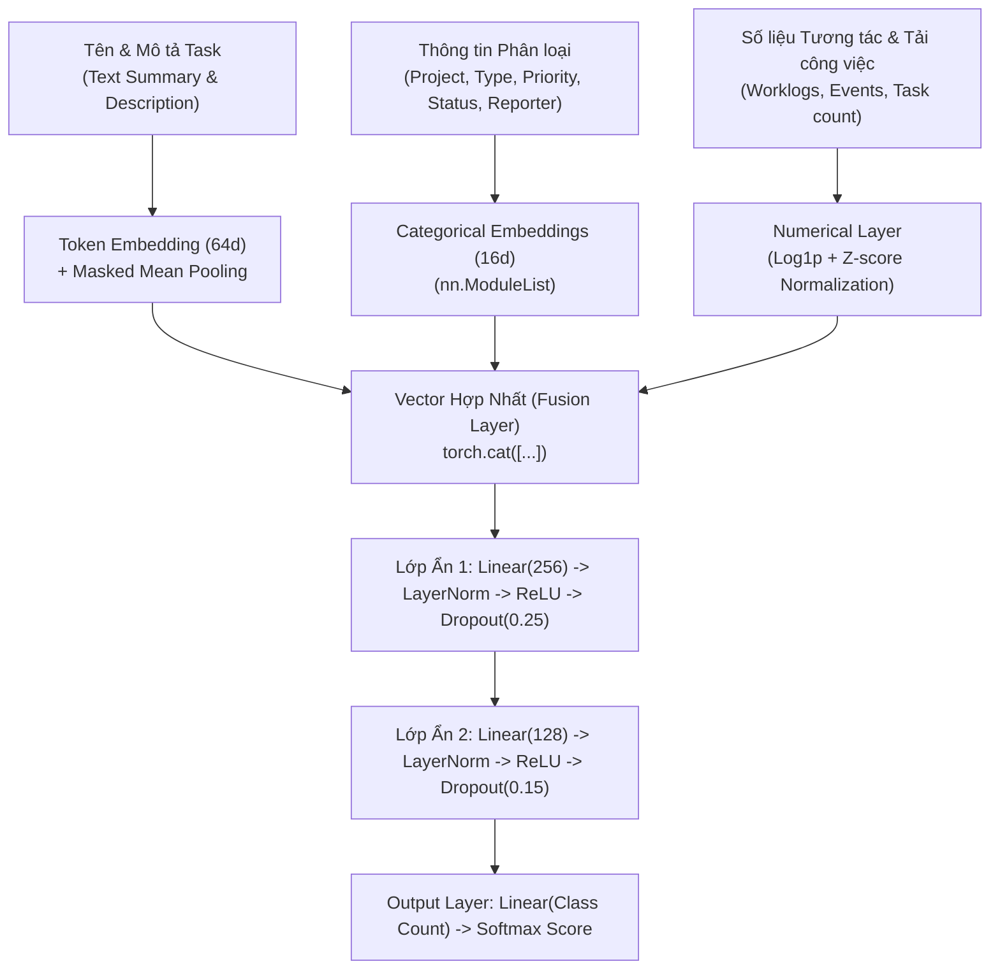

# Báo Cáo & Hướng Dẫn Chi Tiết Hệ Thống AI Đề Xuất Người Xử Lý (Task Assignee Recommender)

Tài liệu này giải thích chi tiết cơ chế hoạt động, nguồn dữ liệu, mô hình học sâu (Deep Learning), các thay đổi cơ sở dữ liệu và luồng xử lý toàn hệ thống cho tính năng **AI Đề xuất Người xử lý** trong dự án TaskPilot.

---

## 1. AI Dựa Vào Đâu Để Đưa Ra Gợi Ý?

Hệ thống AI sử dụng phương pháp **Gợi ý Kết hợp (Hybrid Recommendation)**, kết hợp cả dữ liệu **Lịch sử hoạt động trong quá khứ** và dữ liệu **Ngữ cảnh thực tế thời gian thực**:

```
                               ┌──────────────────────────────────────────────────────────┐
                               │                    DỮ LIỆU ĐẦU VÀO AI                    │
                               └────────────────────────────┬─────────────────────────────┘
                                                            │
                            ┌───────────────────────────────┴───────────────────────────────┐
                            ▼                                                               ▼
        [1. LỊCH SỬ HOẠT ĐỘNG (HISTORICAL DATA)]                          [2. NGỮ CẢNH THỜI GIAN THỰC (REAL-TIME)]
  - Lịch sử phân công công việc tương tự trong quá khứ            - Kỹ năng & Chuyên môn nhân sự (user_skills, job_title)
  - Nhật ký làm việc & thời gian thực hiện (worklogs, hours)       - Tải công việc hiện tại (số task chưa hoàn thành)
  - Lịch sử tương tác, đổi status & assignee (events.csv)         - Trạng thái hoạt động (active) & Thành viên dự án
```

---

## 2. Các Thành Phần Chi Tiết Của Nguồn Dữ Liệu

### A. Dữ liệu Lịch sử (Dùng để huấn luyện mô hình PyTorch Deep Learning)
1. **Lịch sử Phân công & Giải quyết Task**: Học từ các task đã đóng trong quá khứ để hiểu ai là người có chuyên môn giải quyết từng loại công việc (`Bug`, `Task`, `Story`, `Epic`).
2. **Nhật ký thời gian (`worklogs.csv`)**: Phân tích tổng số giờ (`timeSpentSeconds`) và tần suất log thời gian làm việc của từng thành viên.
3. **Lịch sử sự kiện (`events.csv`)**: Số lần chuyển trạng thái công việc (`status`) và số lần bàn giao/chuyển đổi assignee để đánh giá mức độ tương tác của thành viên.

### B. Dữ liệu Thời gian thực (Cập nhật từ CSDL khi bấm "✨ AI Đề xuất")
1. **Kỹ năng & Chuyên môn (`user_skills` & `job_title`)**:
   - AI thực hiện khớp từ khóa giữa tên/mô tả task mới với danh mục kỹ năng của thành viên.
   - *Ví dụ*: Task *"Fix memory leak in MySQL connection"* sẽ tự động nhận diện từ khóa `MySQL`, `database` và tìm thành viên có kỹ năng **Database / SQL / Backend**.
2. **Tải công việc hiện tại (`active_tasks_count`)**:
   - AI truy vấn số lượng task đang giữ ở trạng thái `todo` hoặc `in_progress`.
   - Nếu một người rất giỏi nhưng đang quá tải (VD: giữ 7-8 task), AI sẽ tự động giảm điểm số và ưu tiên thành viên có năng lực phù hợp nhưng **tải công việc nhẹ hơn**.
3. **Trạng thái & Thành viên dự án**:
   - Chỉ gợi ý những tài khoản đang hoạt động (`status = active`) và thuộc dự án hiện tại.

---

## 3. Kiến Trúc Mô Hình Học Sâu PyTorch (`AssigneeNetwork`)

File mã nguồn chính: `AI/assignee_recommender.py`

Mô hình là một mạng Nơ-ron Deep Learning đa nhánh (Multi-Branch Neural Network):



---

## 4. Các Thay Đổi Cơ Sở Dữ Liệu (Database Schema)

Migration: `database/migrations/2026_09_05_000001_create_ai_recommendation_tables.php`

1. **Bảng `user_skills` (Kỹ năng thành viên)**:
   - `user_id`: ID người dùng (Foreign key -> `users.id`)
   - `skill_name`: Tên kỹ năng (VD: `PHP`, `Vue.js`, `Database`, `DevOps`)
   - `proficiency_level`: Mức độ (1-5)
   - `years_experience`: Số năm kinh nghiệm

2. **Bảng `task_skills` (Kỹ năng yêu cầu cho task)**:
   - `task_id`: ID task (Foreign key -> `tasks.id`)
   - `skill_name`: Tên kỹ năng

3. **Bảng `ai_assignee_recommendations` (Lịch sử & Phản hồi AI)**:
   - `task_id`: ID task được gợi ý
   - `user_id`: Thành viên được gợi ý
   - `score`: Điểm độ phù hợp tin cậy (0.0 đến 1.0)
   - `rank_position`: Thứ hạng gợi ý (1, 2, 3...)
   - `match_reasons`: JSON lưu danh sách lý do phù hợp
   - `status`: Phản hồi người dùng (`pending`, `accepted`, `rejected`, `changed`)

---

## 5. Luồng Hoạt Động Hệ Thống (End-to-End Workflow)

```
[1. Người dùng] ──► Nhập tên & mô tả task trên Web ──► Bấm "✨ AI Đề xuất"
                                                               │
                                                               ▼
[2. Vue.js Frontend] ──► POST /tasks/recommend-assignee ──► [3. Laravel Backend]
                                                               │
                                                               ▼
                                              [AiRecommendationService.php]
                                         - Lấy danh sách thành viên dự án
                                         - Đóng gói JSON (skills, active tasks)
                                                               │
                                                               ▼
[5. Vue.js AI Modal] ◄── Trả về JSON ◄── [4. PyTorch AI Script] (assignee_recommender.py)
   - Hiển thị danh sách % match               - Tính điểm xác suất bằng PyTorch
   - Hiển thị Lý do phù hợp                   - Sinh giải thích match_reasons
   - Bấm "Chọn người này" để tự động điền
```

---

## 6. Hướng Dẫn Chạy & Thử Nghiệm

### A. Chạy dự đoán bằng CLI Python:
```bash
.venv/bin/python3 AI/assignee_recommender.py predict --issue-json '{
  "summary": "Fix database connection leak",
  "description": "Slow query execution in task list",
  "issuetype": "Bug",
  "priority": "High",
  "candidate_users": [
    {
      "id": 10,
      "name": "Tuấn TP",
      "job_title": "Backend Engineer",
      "skills": ["database", "php", "sql"],
      "status": "active",
      "active_tasks_count": 2
    }
  ]
}' --top-k 3
```

### B. Chạy Huấn luyện lại Mô hình:
```bash
.venv/bin/python3 AI/assignee_recommender.py train --epochs 8 --batch-size 512
```

### C. Thử nghiệm qua Laravel Tinker:
```bash
php artisan tinker --execute="
$service = new \ProjectsManager\Services\AiRecommendationService();
$res = $service->recommend(['name' => 'Fix database memory leak']);
print_r($res);
"
```
