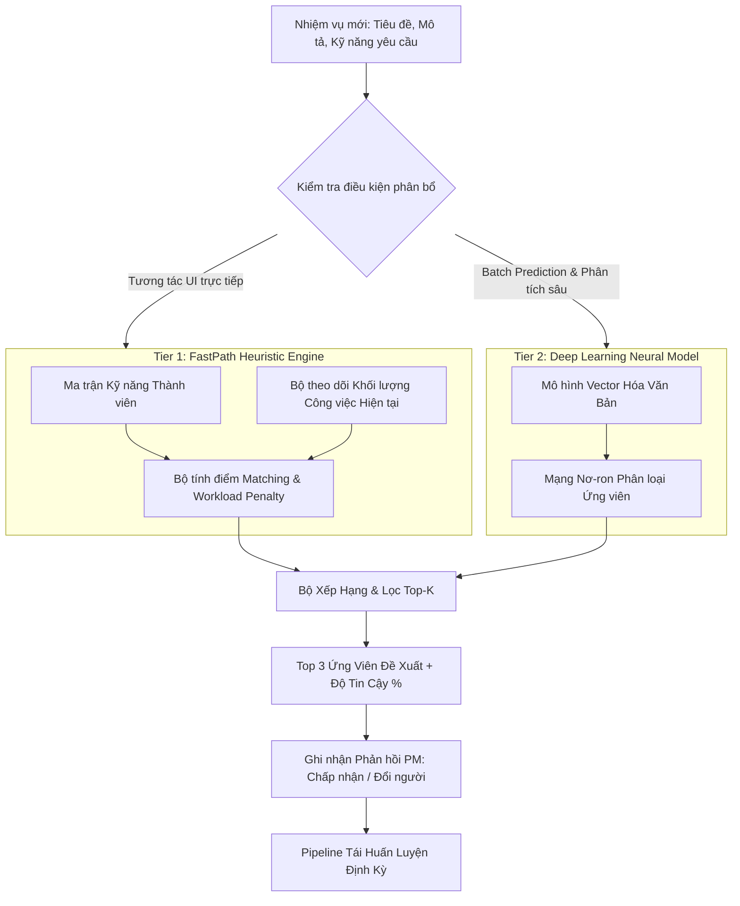

# THIẾT KẾ HỆ THỐNG GỢI Ý PHÂN BỔ NHÂN SỰ BẰNG AI (AI RECOMMENDATION SYSTEM ARCHITECTURE)

```text
Document ID:     TP-AI-001
Classification:  Internal / Machine Learning Engineering
Version:         2.0.0
Author:          Lead Machine Learning Engineer & AI Architect
Target Subsystem:TaskPilot Intelligent Assignee Recommender
Date:            2026-10-14
```

---

## 1. TỔNG QUAN HỆ THỐNG (AI ENGINE OVERVIEW)

Module **AI Assignee Recommendation** trong TaskPilot là hệ thống học máy tự động gợi ý nhân sự phù hợp nhất cho từng nhiệm vụ. Hệ thống giải quyết bài toán cốt lõi trong quản trị dự án: **Giao đúng người, đúng kỹ năng, cân bằng khối lượng công việc, tối ưu hóa tốc độ hoàn thành**.

Hệ thống hoạt động theo mô hình lai hai cấp độ (**Two-Tier Hybrid Architecture**):
1. **Tier 1 - FastPath Heuristic (PHP Native)**: Tính toán siêu tốc độ trễ cực thấp (< 5ms) phục vụ tương tác trực tiếp trên giao diện người dùng.
2. **Tier 2 - Deep Neural Recommender (PyTorch / Python 3.11)**: Phân tích sâu ngữ nghĩa đa chiều của tiêu đề, mô tả và lịch sử thực thi để giải quyết các tác vụ phức tạp.



---

## 2. CÔNG THỨC TOÁN HỌC & ĐÁNH GIÁ (MATHEMATICAL FORMULATION)

### 2.1. Điểm Tương Đồng Kỹ Năng (Skill Overlap Score)
Độ tương đồng giữa tập kỹ năng yêu cầu của công việc $S_{\text{task}}$ và tập kỹ năng của thành viên $S_{\text{user}}$ được tính theo hệ số Jaccard mở rộng:

$$\text{SkillScore}(u, t) = \frac{|S_{\text{task}} \cap S_u|}{|S_{\text{task}}|}$$

### 2.2. Hệ Số Phạt Tải Công Việc (Workload Penalization Factor)
Để tránh tình trạng quá tải (burnout) cho các nhân sự giỏi, hệ số tải công việc được chuẩn hóa bằng hàm suy giảm hyperbolic:

$$W(u) = \frac{1}{1 + \alpha \cdot \frac{H_u}{H_{\text{standard}}}}$$

* Trong đó:
  * $H_u$: Tổng số giờ công việc đang dang dở (in-progress / open) của thành viên $u$.
  * $H_{\text{standard}}$: Ngưỡng tải công việc tiêu chuẩn tuần (ví dụ: 40 giờ).
  * $\alpha$: Trọng số kiểm soát độ phạt tải ($\alpha = 0.5$).

### 2.3. Điểm Xếp Hạng Cuối Cùng (Final Composite Score)
$$\text{Score}(u, t) = \beta \cdot \text{SkillScore}(u, t) + (1 - \beta) \cdot W(u)$$
*(Mặc định $\beta = 0.7$, ưu tiên kỹ năng đúng chuyên môn 70% và cân bằng tải 30%).*

---

## 3. THANG ĐO ĐÁNH GIÁ ĐỘ CHÍNH XÁC (MEAN RECIPROCAL RANK - MRR)

Chất lượng của mô hình gợi ý được đánh giá định kỳ trên tập dữ liệu kiểm thử thực tế thông qua chỉ số **Mean Reciprocal Rank (MRR)**:

$$\text{MRR} = \frac{1}{|Q|} \sum_{i=1}^{|Q|} \frac{1}{\text{rank}_i}$$

* $\text{rank}_i$: Thứ hạng của nhân sự thực tế hoàn thành tốt task đó trong danh sách gợi ý của mô hình.
* **Mục tiêu kỹ thuật**: $\text{MRR} \ge 0.75$ (Nghĩa là người phù hợp nhất luôn nằm trong Top 1 hoặc Top 2 của danh sách đề xuất).

---

## 4. QUY TRÌNH TÁI HUẤN LUYỆN ĐỊNH KỲ (CONTINUOUS LEARNING PIPELINE)

1. Khi Project Manager chấp nhận gợi ý của AI hoặc tự tay chọn một nhân sự khác, sự kiện được ghi vào bảng `ai_recommendation_feedbacks`.
2. Hằng tuần, một cron job tự động trích xuất các lượt phản hồi này để:
   * Cập nhật lại trọng số kỹ năng của từng thành viên.
   * Huấn luyện bù (Fine-tuning) mô hình PyTorch với learning rate nhỏ ($10^{-5}$).
   * Chạy lại test suite kiểm tra MRR tại `AI/test_reciprocal_rank.py` trước khi cập nhật model weights lên production.

---

*Tài liệu được biên soạn và bảo trì bởi Nhóm Kỹ nghệ Học máy TaskPilot.*
