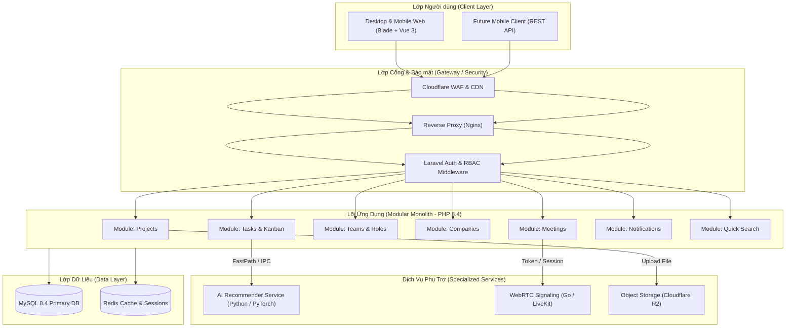
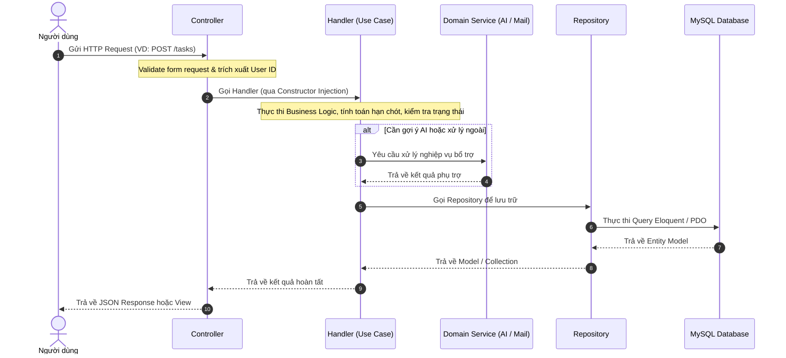
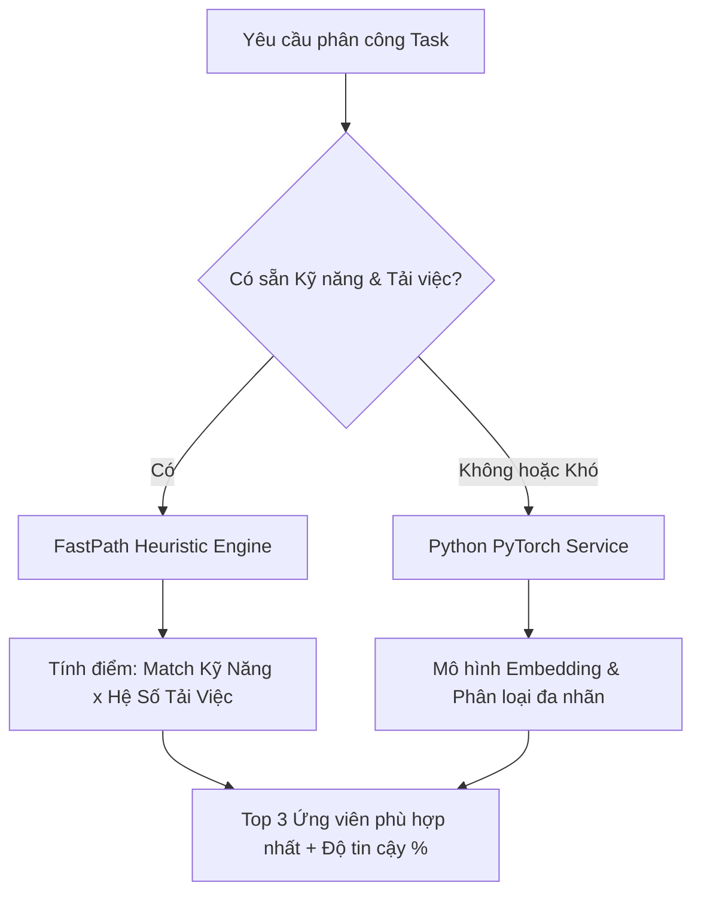

# TÀI LIỆU THIẾT KẾ KIẾN TRÚC HỆ THỐNG (SYSTEM ARCHITECTURE SPECIFICATION)

```text
Document ID:     TP-ARCH-001
Classification:  Internal / Engineering Core
Version:         2.0.0
Author:          Principal Enterprise Architect
Status:          Approved
Target System:   TaskPilot Platform
Date:            2026-10-14
```

---

## 1. TỔNG QUAN KIẾN TRÚC (HIGH-LEVEL ARCHITECTURE)

TaskPilot áp dụng kiến trúc **Modular Monolith** kết hợp với các dịch vụ chuyên biệt (**Polyglot Microservices** cho AI và WebRTC). Kiến trúc này giúp hệ thống đạt được sự cân bằng tối ưu giữa:
* **Tốc độ phát triển**: Đơn giản trong việc kiểm thử, refactor và triển khai toàn bộ ứng dụng trên một pipeline CI/CD duy nhất.
* **Tính độc lập miền (Domain Independence)**: Các module nghiệp vụ được đóng gói độc lập trong các thư mục con của `app/Modules/`, sẵn sàng tách thành Microservices độc lập trong tương lai khi lưu lượng tăng trưởng lớn.
* **Hiệu năng cao**: Tận dụng PHP 8.4 với OPcache/JIT cho các tác vụ nghiệp vụ, Python/PyTorch cho suy luận AI học máy, và Go cho xử lý kết nối WebRTC thời gian thực với độ trễ thấp.



---

## 2. QUY CHUẨN PHÂN TẦNG VÀ LUỒNG PHỤ THUỘC (LAYERED ARCHITECTURE)

Hệ thống bắt buộc tuân thủ nguyên tắc **Phụ thuộc một chiều (Strict Unidirectional Dependency Flow)**:

$$\text{Controller} \longrightarrow \text{Handler} \longrightarrow \text{Repository} \longrightarrow \text{Model} \longrightarrow \text{Database}$$



### Các nguyên tắc cốt lõi:
1. **Controller (Presentation Layer)**:
   * **Nhiệm vụ**: Nhận HTTP request, ủy quyền kiểm tra validation cho `FormRequest`, gọi Handler tương ứng, và trả về Response (JSON hoặc View).
   * **Cấm kỵ**: Tuyệt đối **không** viết câu lệnh truy vấn database (`DB::`, `Model::where()`), không xử lý nghiệp vụ hay tính toán số liệu tại Controller.
2. **Handler (Application / Use Case Layer)**:
   * **Nhiệm vụ**: Đại diện cho duy nhất **1 Use Case** cụ thể của hệ thống (ví dụ: `CreateTaskHandler`, `ListProjectsHandler`, `ArchiveProjectHandler`). Chịu trách nhiệm thực thi toàn bộ logic nghiệp vụ của Use Case đó.
   * **Giao tiếp**: Được phép gọi Repository, Domain Services, và bắn Event (Domain Events).
3. **Repository (Data Access Layer)**:
   * **Nhiệm vụ**: Che giấu cơ chế lưu trữ dữ liệu thực tế. Cung cấp các phương thức truy vấn tường minh: `findById()`, `getProjectsForUser()`, `getOverdueTasks()`.
4. **Service (Cross-Cutting / Domain Service)**:
   * Được sử dụng cho các nghiệp vụ dùng chung giữa nhiều module hoặc tương tác với hệ thống ngoài (ví dụ: `AiRecommendationService`, `CloudflareR2StorageService`, `NotificationDispatcherService`).

---

## 3. CẤU TRÚC THƯ MỤC CỦA MỘT MODULE CHUẨN

Mỗi thư mục con trong `app/Modules/<ModuleName>/` được tổ chức khép kín:

```text
app/Modules/Projects/
├── Controllers/
│   ├── ProjectsController.php           <- Thin Controller
│   └── ProjectToolsController.php
├── Handlers/
│   ├── ListProjectsHandler.php          <- Use Case: Danh sách dự án
│   ├── CreateProjectHandler.php         <- Use Case: Mở form tạo
│   ├── StoreProjectHandler.php          <- Use Case: Lưu dự án mới
│   ├── ShowProjectHandler.php           <- Use Case: Xem chi tiết
│   └── ArchiveProjectHandler.php        <- Use Case: Lưu trữ dự án
├── Repositories/
│   └── ProjectRepository.php            <- Tương tác trực tiếp DB
├── Requests/
│   ├── StoreProjectRequest.php          <- Validation dữ liệu đầu vào
│   └── UpdateProjectRequest.php
└── Resources/
    └── ProjectResource.php              <- Định dạng JSON trả về API
```

---

## 4. KIẾN TRÚC TÍCH HỢP AI RECOMMENDATION (AI INFERENCE PIPELINE)

Hệ thống phân bổ công việc thông minh sử dụng kiến trúc lai hai cấp độ (**Two-Tier Hybrid Recommendation**):



* **Cấp 1 - FastPath Heuristic (PHP Native)**: Thời gian phản hồi **< 5ms**. Tính toán dựa trên độ tương đồng giữa từ khóa kỹ năng của task và ma trận kỹ năng của thành viên, kết hợp với chỉ số khối lượng công việc hiện tại (current workload).
* **Cấp 2 - Deep Learning Inference (Python / PyTorch)**: Phân tích sâu ngữ nghĩa của tiêu đề và mô tả task phức tạp để dự đoán người nhận việc phù hợp nhất dựa trên lịch sử giải quyết vấn đề tương tự.

---

## 5. THIẾT KẾ GIAO DIỆN PHÍA CLIENT (FRONTEND ARCHITECTURE)

1. **Vỏ bọc ứng dụng (Application Shell - Layout Layer)**:
   * Tổ chức theo mô hình **Vertical Sidebar + Sticky Topbar**.
   * State thu gọn (`tp-sidebar-collapsed`) được lưu tại `localStorage` để duy trì giao diện người dùng yêu thích xuyên suốt các phiên làm việc.
2. **Kiến trúc đảo giao diện (Island Architecture / Hybrid Blade-Vue)**:
   * **Blade Layout**: Đóng vai trò khung xương SSR (Server-Side Rendering) giúp SEO tốt, tải trang nhanh và bảo vệ route phía server.
   * **Vue 3 Islands**: Các thành phần tương tác mạnh (Kanban Drag-and-drop, Project Timeline Gantt, Task Matrix, Quick Search Dropdown) được nhúng độc lập bằng Vue 3 Composition API mà không cần biến toàn bộ website thành SPA cồng kềnh.
3. **Hệ thống Design Tokens (CSS Variables)**:
   * Tập trung tại `public/css/sidebar-layout.css` và `public/css/custom-ui.css`.
   * Hỗ trợ chuẩn hóa màu sắc, kích thước, hiệu ứng bóng mờ (box-shadow) và sẵn sàng tích hợp Chế độ ban đêm (Dark Mode).

---

## 6. ĐẢM BẢO KHẢ NĂNG MỞ RỘNG (SCALABILITY & AVAILABILITY)

| Thành phần | Chiến lược mở rộng hiện tại | Giải pháp khi lưu lượng tăng trưởng lớn |
| :--- | :--- | :--- |
| **PHP App Engine** | PHP-FPM với tiến trình động | Chạy đa container Kubernetes (HPA), stateless application |
| **Cơ sở dữ liệu** | Single Primary MySQL 8.4 | Tách Read/Write Split (1 Master - 2 Read Replicas) |
| **Lưu trữ tệp tin** | Cloudflare R2 qua S3 API | Phân tán CDN toàn cầu, băng thông tải về 0đ |
| **Dịch vụ AI** | FastPath Heuristic + CLI process | Tách thành Microservice FastAPI chuyên biệt chạy trên cụm GPU/CPU riêng |
| **Thời gian thực** | WebRTC Go daemon độc lập | Cụm LiveKit Server kết nối Redis Mesh |

---

*Tài liệu được kiểm duyệt bởi Hội đồng Kiến trúc Kỹ thuật TaskPilot.*
