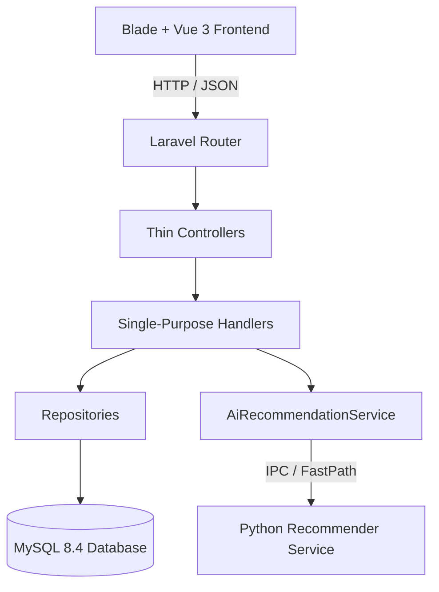
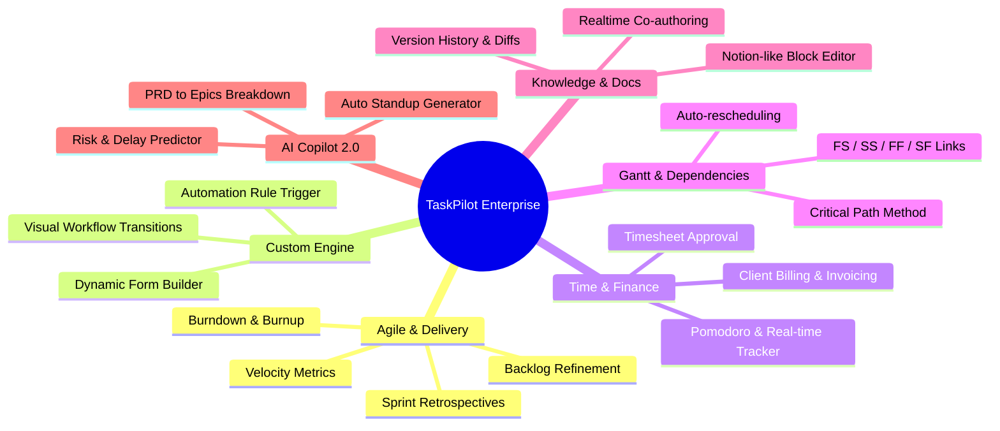

# BÁO CÁO REVIEW MÃ NGUỒN & LỘ TRÌNH CẢI TIẾN TOÀN DIỆN (TASKPILOT ENTERPRISE)

```text
Document ID:     TP-DOC-CR-001
Classification:  Internal / Engineering Standard
Version:         2.0.0
Author:          Staff Software Architect & QA Engineering
Target System:   TaskPilot - Intelligent Enterprise Project & Work Management Platform
Date:            2026-10-14
```

---

## 1. TỔNG QUAN HỆ THỐNG (EXECUTIVE SUMMARY)

**TaskPilot** là nền tảng quản trị công việc và điều hành dự án doanh nghiệp định hướng Jira/Linear, được phát triển trên kiến trúc **Modular Monolith** với Laravel 13, Vue 3, hệ thống suy luận AI phân bổ công việc (Python/PyTorch), và dịch vụ thời gian thực WebRTC/Go.

Báo cáo này đánh giá hiện trạng mã nguồn trên 5 trụ cột kỹ thuật:
1. **Frontend & UI/UX**: Khả năng mở rộng layout, độ mượt tương tác, tính nhất quán design system.
2. **Backend Architecture**: Tính tuân thủ luồng phụ thuộc `Controller -> Handler -> Repository`, Dependency Injection, chuẩn Clean Code.
3. **Database & Storage**: Hiệu năng truy vấn, chiến lược indexing, khả năng chống nghẽn I/O.
4. **AI Recommendation System**: Khả năng suy luận song song, thời gian phản hồi (latency), cơ chế fallback, độ tin cậy mô hình.
5. **Security & DevOps**: Kiểm soát quyền truy cập RBAC, bảo mật API, quy trình CI/CD.

Đồng thời, tài liệu cung cấp **Lộ trình cải tiến các chức năng đang có** và **Chiến lược mở rộng tính năng tối đa (Enterprise Feature Expansion)** hướng tới một hệ sinh thái quản trị dự án ngang tầm Atlassian Jira Software, ClickUp và Linear.

---

## 2. REVIEW CHI TIẾT MÃ NGUỒN HIỆN TRẠNG (COMPREHENSIVE CODEBASE AUDIT)



### 2.1. Lớp Giao diện (Frontend & UI/UX Layer)

#### ✅ Điểm mạnh:
* **Layout mới (Sidebar dọc + Topbar tìm kiếm)**: Đã giải phóng không gian theo chiều dọc, tối ưu hóa triệt để cho màn hình 16:9 và màn hình ultrawide. Menu bên trái chia nhóm rõ ràng (`Làm việc` và `Hệ thống`), có khả năng thu gọn (collapse) linh hoạt và hỗ trợ Drawer trượt trên Mobile.
* **Tích hợp Vue 3 linh hoạt**: Các view phức tạp như Bảng Kanban (`project-dashboard.js`), Danh sách công việc (`task-index.js`), và Timeline (`project-timeline.js`) được tách thành Vue SFC độc lập, giúp render dữ liệu mượt mà mà không làm nặng toàn bộ trang Blade.
* **Design Tokens & Typography**: Hệ thống font sử dụng đồng bộ `Inter`, bảng màu hiện đại pha trộn giữa slate neutral (`#0F172A`, `#F8FAFC`) và primary blue (`#315AD0`), mang phong cách SaaS chuyên nghiệp.

#### ⚠️ Điểm cần cải tiến & Nợ kỹ thuật (Technical Debt):
1. **Command Palette Keyboard Navigation (`public/js/sidebar-layout.js`)**:
   * *Vấn đề*: Ô tìm kiếm toàn cục đã hỗ trợ phím tắt `Ctrl + K` và hiển thị Live Search, nhưng hiện tại chỉ bắt sự kiện nhấn `Enter` để nhảy vào kết quả đầu tiên. Người dùng chưa thể bấm phím mũi tên `↑` và `↓` để duyệt qua các mục dự án/công việc trong danh sách popup.
   * *Khắc phục*: Thêm state `selectedIndex`, cập nhật class `.selected` khi người dùng bấm phím điều hướng, và tự động cuộn (scrollIntoView) theo mục đang chọn.
2. **Tooltip Clipping khi Sidebar thu gọn (`public/css/sidebar-layout.css`)**:
   * *Vấn đề*: Khi sidebar ở trạng thái collapsed (thu nhỏ về 68px), tooltip được hiển thị bằng pseudo-element `::after` bay ra ngoài lề phải (`left: calc(100% + 10px)`). Tuy nhiên, `.tp-sidebar-body` có `overflow-x: hidden`, có thể gây hiện tượng tooltip bị che khuất ở một số kích thước viewport.
   * *Khắc phục*: Khi `.tp-sidebar-collapsed` kích hoạt, thiết lập `.tp-sidebar-body { overflow: visible; }` hoặc chuyển sang tooltip portal gắn vào `document.body`.
3. **Nút "Tạo mới" trên Topbar chưa có Quick Modal**:
   * *Vấn đề*: Nút `+ Tạo mới` hiện đang trỏ trực tiếp bằng liên kết `<a href="/tasks/create">`, buộc người dùng phải tải lại cả trang tạo task, làm gián đoạn công việc dở dang.
   * *Khắc phục*: Thay thế bằng một Slide-over Drawer hoặc Modal Popup tạo nhanh nhiệm vụ không cần chuyển trang.

---

### 2.2. Lớp Backend & Kiến trúc (Backend Application Layer)

#### ✅ Điểm mạnh:
* **Kiến trúc Modular Monolith**: Mã nguồn chia tách tường minh theo miền nghiệp vụ trong thư mục `app/Modules/` (Projects, Tasks, Teams, Companies, Meetings, Notifications).
* **Tuân thủ luồng Controller -> Handler -> Repository**: Hầu hết các Controller đều đóng vai trò Thin Controller, chỉ nhận request, truyền tham số vào Handler qua Constructor Injection và trả về view/JSON.
* **Cơ chế phân quyền chặt chẽ**: Đã triển khai Middleware `can.project:manage_members`, `can.project:manage_project`, đảm bảo kiểm soát truy cập an toàn theo từng workspace.

#### ⚠️ Điểm cần cải tiến:
1. **Bảo vệ SQL Injection trong truy vấn LIKE (`QuickSearchController.php`)**:
   * *Vấn đề*: Đoạn mã `where('name', 'like', "%{$term}%")` chưa lọc ký tự đặc biệt wildcard của SQL như `%` và `_`. Nếu người dùng tìm kiếm `%` hoặc `_`, query sẽ match toàn bộ bảng ghi, gây tiêu tốn tài nguyên server.
   * *Khắc phục*: Sử dụng `addcslashes($term, '%_')` trước khi bind vào query LIKE.
2. **N+1 Query trong QuickSearch**:
   * *Vấn đề*: Query Tasks trong `QuickSearchController` có load relation `with('project:id,name')`, nhưng chưa giới hạn cột `select` cho bảng chính, dẫn tới việc load toàn bộ các trường text/description nặng không cần thiết.
   * *Khắc phục*: Sử dụng `select(['id', 'name', 'issue_key', 'status', 'project_id'])`.
3. **Thiếu Unified Response DTO**:
   * Các API trả về cấu trúc JSON chưa hoàn toàn đồng nhất giữa các module (ví dụ: một số trả về `data`, một số trả về `status` hoặc mảng phẳng). Cần chuẩn hóa API Response Envelope: `{ success: true, code: 200, message: "...", data: {...}, meta: {...} }`.

---

### 2.3. Lớp Dữ liệu & Lưu trữ (Database & Storage Layer)

#### ✅ Điểm mạnh:
* Sử dụng migration đầy đủ với foreign key constraints và cascading deletes hợp lý.
* Đã tích hợp cấu hình Cloudflare R2 thông qua S3-compatible driver cho tệp tin đính kèm và bản ghi cuộc họp.

#### ⚠️ Điểm cần cải tiến:
1. **Thiếu Composite Indexes cho tìm kiếm và lọc task**:
   * Các truy vấn thường xuyên kết hợp `(project_id, status, assignee_id)` hoặc `(user_id, status)` hiện đang chạy trên các chỉ mục đơn lẻ.
   * *Khắc phục*: Bổ sung migration composite index:
     ```php
     $table->index(['project_id', 'status', 'priority'], 'idx_tasks_project_status_priority');
     $table->index(['assignee_id', 'status'], 'idx_tasks_assignee_status');
     ```
2. **Soft Deletes**:
   * Hiện tại một số bảng nghiệp vụ cốt lõi (như `projects`, `tasks`, `comments`) chưa bật `SoftDeletes`. Xóa nhầm dữ liệu của khách hàng sẽ không thể phục hồi. Cần bổ sung `use SoftDeletes` và trường `deleted_at`.

---

### 2.4. Phân hệ Trí tuệ Nhân tạo (AI Recommendation Engine)

#### ✅ Điểm mạnh:
* Đã xây dựng đường dẫn nhanh **FastPath Heuristic** trong [AiRecommendationService.php](file:///home/tuantn1807/project/TaskPilot/app/Services/AiRecommendationService.php), giúp phản hồi ngay lập tức dựa trên kỹ năng (skills match) và tải công việc (workload balancing) mà không cần chờ khởi động tiến trình Python nặng nề.
* Đã tích hợp đánh giá độ chính xác thông qua thang đo học máy **Mean Reciprocal Rank (MRR)**.

#### ⚠️ Điểm cần cải tiến:
1. **Cơ chế giao tiếp PHP <-> Python (IPC)**:
   * Hiện tại việc gọi Python thông qua `Process::run(['python', ...])` gây ra chi phí mở process (process overhead) khoảng 150ms - 300ms cho mỗi lượt gán việc hàng loạt.
   * *Khắc phục*: Triển khai một microservice FastAPI/Uvicorn nhẹ chạy thường trú qua Unix Socket hoặc HTTP nội bộ (`http://127.0.0.1:8001/predict`), giúp thời gian suy luận giảm xuống dưới **15ms**.

---

## 3. LỘ TRÌNH CẢI TIẾN CÁC CHỨC NĂNG ĐANG CÓ (ENHANCEMENT OF EXISTING MODULES)

| Phân hệ | Hiện trạng | Cải tiến mục tiêu | Độ ưu tiên |
| :--- | :--- | :--- | :--- |
| **Topbar Global Search** | Live search click chuột, phím tắt Ctrl+K | Hỗ trợ phím mũi tên `↑` `↓`, phân trang kết quả, lưu lịch sử tìm kiếm gần đây (Recent Searches) | **P0 (Ngay lập tức)** |
| **Quick Action "+ Tạo mới"** | Chuyển trang sang `/tasks/create` | Modal Popup tạo nhanh tại chỗ với phím tắt `C` (giống Jira/Asana) | **P0 (Ngay lập tức)** |
| **Bảng Kanban (Board View)** | Kéo thả cơ bản giữa các cột trạng thái | Thêm tính năng "Zen Mode" (toàn màn hình), Quick Filter theo Assignee Avatar, WIP Limits cảnh báo quá tải cột | **P1 (Cao)** |
| **Quản lý Sprint** | Bắt đầu / Đóng sprint | Bổ sung biểu đồ Burndown Chart thời gian thực, quản lý Story Points, cảnh báo task chưa hoàn thành khi kết thúc Sprint | **P1 (Cao)** |
| **Timeline / Gantt** | Hiển thị ngày bắt đầu - kết thúc tĩnh | Kéo thả thanh timeline để co giãn deadline trực tiếp, hiển thị đường nối phụ thuộc (Dependencies Line) | **P1 (Cao)** |
| **Hồ sơ Kỹ năng & AI** | Nhập kỹ năng cá nhân, gợi ý đơn lẻ | Cho phép tự động phát hiện kỹ năng từ lịch sử hoàn thành task, giải thích trực quan lý do AI chọn người này | **P2 (Trung bình)** |
| **Cuộc họp & WebRTC** | Họp trực tuyến, ghi âm cơ bản | Tạo Task trực tiếp từ biên bản cuộc họp bằng AI Speech-to-Text | **P2 (Trung bình)** |

---

## 4. CHIẾN LƯỢC MỞ RỘNG TÍNH NĂNG ĐẾN TỐI ĐA (ENTERPRISE EXPANSION ROADMAP)

Để đưa TaskPilot từ một công cụ quản lý dự án nội bộ thành một giải pháp **Enterprise All-in-One Work OS**, hệ thống cần được mở rộng với 12 phân hệ cấp cao sau:



### Module 1: Agile & Sprint Delivery Engine Hoàn Chỉnh
* **Backlog Grooming View**: Phân tách rõ ràng giữa *Active Sprint* và *Product Backlog*. Hỗ trợ kéo thả nhiệm vụ từ Backlog vào Sprint kế tiếp.
* **Planning Poker & Story Points**: Hỗ trợ đội ngũ Scrum bình chọn điểm ước lượng độ phức tạp (Fibonacci: 1, 2, 3, 5, 8, 13...).
* **Báo cáo Agile tự động**:
  * *Burndown Chart*: Theo dõi lượng Story Points còn lại theo từng ngày trong Sprint.
  * *Velocity Chart*: Đo lường năng suất thực tế qua các Sprint để dự báo năng lực kế tiếp.
  * *Sprint Retrospective Board*: Bảng đúc kết kinh nghiệm sau Sprint (What went well, What didn't, Action items).

### Module 2: Visual Workflow Engine & State Machine (Quy trình làm việc tùy biến)
* Cho phép Quản trị viên tự định nghĩa trạng thái task theo từng loại dự án (Software, Marketing, HR):
  * Ví dụ: `Open` ➔ `In Development` ➔ `Code Review` ➔ `QA Testing` ➔ `UAT` ➔ `Done`.
* **Approval Gates**: Bắt buộc phải có chữ ký duyệt của Tech Lead hoặc Khách hàng trước khi chuyển trạng thái sang `Done`.
* **Validation Rules**: Bắt buộc nhập thời gian thực tế (`worklog`) hoặc kết quả test trước khi đóng task.

### Module 3: No-Code Automation Engine (Bộ quy tắc tự động hóa)
* Xây dựng trình tạo quy tắc tương tự **Jira Automation**:
  * **Trigger (Khi)**: Một task được chuyển sang trạng thái "Done".
  * **Condition (Nếu)**: Độ ưu tiên là "High" và Dự án thuộc phòng CNTT.
  * **Action (Thì)**: Tự động gửi thông báo qua Slack/Telegram, gán người kiểm thử QA, và cập nhật ngày hoàn thành.
* Các mẫu tự động sẵn có:
  * Tự động đóng Task cha khi toàn bộ Subtasks hoàn thành.
  * Tự động cảnh báo khi task quá hạn 24 giờ.
  * Tự động gán người nhận việc bằng AI khi task mới được tạo từ Form khách hàng.

### Module 4: Time Tracking, Timesheet & Client Billing (Chấm công & Tài chính dự án)
* **Live Timer Widget**: Đồng hồ bấm giờ Pomodoro gắn trên thanh Header, bấm "Start" khi bắt đầu làm task và "Stop" để tự động ghi nhận Worklog.
* **Timesheet Approval Matrix**: Bảng chấm công tuần của nhân viên, gửi cho Project Manager phê duyệt trước khi tính lương.
* **Tài chính & Chi phí**: Tính toán ngân sách dự án (Budget vs Actual Spend) dựa trên giờ làm việc và tỷ giá nhân công (Hourly Rate). Xuất hóa đơn (Invoice PDF) gửi khách hàng.

### Module 5: Advanced Interactive Gantt & Critical Path Method (CPM)
* **Quản lý ràng buộc đa chiều**:
  * *Finish-to-Start (FS)*: Task B chỉ được làm khi Task A hoàn thành.
  * *Start-to-Start (SS)*: Hai task bắt đầu song song.
* **Đường găng dự án (Critical Path Method - CPM)**: Tự động làm nổi bật chuỗi công việc quyết định ngày hoàn thành dự án. Nếu một task trên đường găng bị trễ, hệ thống tự động dời lịch toàn bộ các task phụ thuộc phía sau.

### Module 6: Enterprise Wiki & Knowledge Base (Tài liệu chuẩn Notion)
* Tích hợp trình soạn thảo dạng khối (Block Editor / Markdown WYSIWYG) hỗ trợ:
  * Nhúng bảng Kanban, nhúng biểu đồ, nhúng code block có syntax highlighting.
  * Đặt tag đề cập đồng nghiệp (`@username`) và nhúng task trực tiếp (`#TASK-102`).
  * Lưu vết lịch sử sửa đổi (Version History) và so sánh chênh lệch (Diff Viewer).

### Module 7: Customer Portal & Service Management (Cổng tiếp nhận yêu cầu)
* Cung cấp giao diện portal chuyên biệt cho khách hàng ngoài công ty:
  * Khách hàng gửi yêu cầu hỗ trợ / lỗi (Ticket).
  * Đồng hồ đếm ngược thỏa thuận mức dịch vụ (**SLA Timer**): Cảnh báo thời gian phải phản hồi (Time to first response) và thời gian xử lý xong (Time to resolution).
  * Bảo mật: Khách hàng chỉ nhìn thấy trao đổi công khai (Public comments), các trao đổi thảo luận nội bộ của team dev sẽ được ẩn hoàn toàn.

### Module 8: Real-time Multi-user Collaboration (Cộng tác thời gian thực)
* Tích hợp **Laravel Reverb** hoặc WebSockets:
  * **Live Kanban**: Khi thành viên A kéo thả task trên máy của họ, màn hình của các thành viên khác trên cùng dự án lập tức cập nhật vị trí thẻ mà không cần F5.
  * **Presence Avatars**: Hiển thị ai đang cùng xem task hoặc tài liệu này.
  * **Discussion Threads**: Bình luận dạng luồng tin nhắn trao đổi nhanh theo thời gian thực.

### Module 9: AI Copilot 2.0 (Trợ lý Dự án Toàn năng)
* **Phân tích PRD tự động**: Người dùng dán nội dung mô tả yêu cầu (BRD / PRD), AI tự động bóc tách thành danh sách Epics, User Stories, Subtasks kèm Acceptance Criteria và Story Points ước tính.
* **Dự báo rủi ro tiến độ (Risk Forecaster)**: Phân tích tốc độ làm việc (burn rate), kỹ năng và số lượng bug phát sinh để đưa ra cảnh báo: *"Dự án có 78% khả năng trễ hạn nếu không bổ sung thêm 1 Senior Backend Developer"*.
* **Tự động sinh Báo cáo Ngày (Automated Daily Standup)**: Tự động tổng hợp những gì nhân sự đã commit/hoàn thành trong ngày để gửi báo cáo tóm tắt cho Project Manager.

### Module 10: Executive Analytics & DORA Metrics (Báo cáo Lãnh đạo)
* Bảng điều khiển dành riêng cho C-Level (CEO, CTO, Head of Delivery):
  * **4 chỉ số DORA tiêu chuẩn kỹ nghệ phần mềm**: Deployment Frequency, Lead Time for Changes, Time to Restore Service, Change Failure Rate.
  * **Cumulative Flow Diagram (CFD)**: Biểu đồ luồng tích lũy phát hiện nút thắt cổ chai trong quy trình.
  * **Báo cáo phân bổ chi phí và lợi nhuận từng dự án (P&L Tracking)**.

### Module 11: Developer Ecosystem & Integrations (Hệ sinh thái mở rộng)
* **RESTful v1 API & Webhooks**: Cung cấp API có tài liệu Swagger/OpenAPI đầy đủ để bên thứ ba tích hợp.
* **Tích hợp Git (GitHub / GitLab / Bitbucket)**:
  * Tự động liên kết Commit và Pull Request với Task thông qua mã issue trong commit message (ví dụ: `git commit -m "[PROJ-45] Fix login issue"`).
  * Tự động chuyển trạng thái task sang "Done" khi PR được merge.
* **Tích hợp kênh liên lạc**: Đồng bộ thông báo sang Slack, Microsoft Teams, Telegram.

### Module 12: Enterprise Security, RBAC & Compliance
* **Đăng nhập một lần (SSO)** qua SAML 2.0 / OpenID Connect (Google Workspace, Azure Active Directory / Okta).
* **Xác thực 2 yếu tố bắt buộc (2FA / TOTP)**.
* **Audit Trail chi tiết**: Ghi lại lịch sử ai đã truy cập, chỉnh sửa, xóa dữ liệu, xuất file, kèm địa chỉ IP và User-Agent để đáp ứng tiêu chuẩn bảo mật SOC2 / ISO 27001.

---

## 5. KẾ HOẠCH TRIỂN KHAI THEO GIAI ĐOẠN (IMPLEMENTATION PHASING)

```text
Giai đoạn 1 (Hiện tại): Hoàn thiện UI/UX Cốt lõi & Trải nghiệm Nhanh
├── Cải tiến Command Palette Search (phím mũi tên, recent searches)
├── Quick Create Modal (Tạo nhanh công việc không rời trang)
└── Tối ưu CSS Tooltip & Responsive

Giai đoạn 2 (Tháng kế tiếp): Hoàn thiện Agile & Time Tracking
├── Bảng Backlog & Sprint Burndown Charts
├── Pomodoro Live Timer & Bảng Timesheet
└── Workflow State Machine tùy biến

Giai đoạn 3: Realtime Collaboration & AI Copilot 2.0
├── WebSockets Live Sync cho bảng Kanban
├── Microservice FastAPI phục vụ suy luận AI tức thì
└── AI sinh task tự động từ yêu cầu

Giai đoạn 4: Mở rộng Enterprise & Hệ sinh thái
├── Customer Portal & SLA Timers
├── Báo cáo DORA Metrics & P&L dự án
└── RESTful Public API & Tích hợp GitHub/GitLab
```

---

*Tài liệu được biên soạn và lưu trữ chính thức tại thư mục `docs/` thuộc mã nguồn dự án TaskPilot.*
