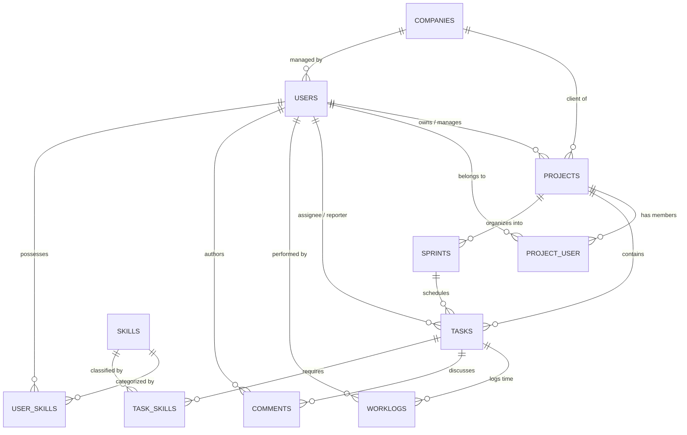

# THIẾT KẾ CƠ SỞ DỮ LIỆU & CHIẾN LƯỢC CHỈ MỤC (DATABASE DESIGN & INDEXING STRATEGY)

```text
Document ID:     TP-DB-001
Classification:  Internal / Data Engineering
Version:         2.0.0
Author:          Database Administrator & Senior Data Architect
Target RDBMS:    MySQL 8.4 Enterprise / Percona Server
Date:            2026-10-14
```

---

## 1. SƠ ĐỒ THỰC THỂ QUAN HỆ (ENTITY RELATIONSHIP DIAGRAM - ERD)



---

## 2. TỪ ĐIỂN DỮ LIỆU CÁC BẢNG TRỌNG YẾU (DATA DICTIONARY)

### 2.1. Bảng `projects` (Quản lý Dự án)
* **Khóa chính**: `id` (`BIGINT UNSIGNED AUTO_INCREMENT`).
* **Các trường cốt lõi**:
  * `name` (`VARCHAR(255)`): Tên dự án.
  * `project_code` (`VARCHAR(50)`, Index): Mã định danh dự án (Ví dụ: `PROJ`, `PILOT`).
  * `company_id` (`BIGINT UNSIGNED`, Nullable): Khách hàng đối tác sở hữu dự án.
  * `user_id` (`BIGINT UNSIGNED`): Người tạo dự án (Project Owner).
  * `status` (`ENUM('active', 'on_hold', 'completed', 'archived')`): Trạng thái dự án.
  * `start_date`, `end_date` (`DATE`, Nullable): Khung thời gian thực hiện.
  * `budget` (`DECIMAL(12, 2)`, Nullable): Ngân sách dự án.

### 2.2. Bảng `tasks` (Quản lý Nhiệm vụ & Thẻ Kanban)
* **Khóa chính**: `id` (`BIGINT UNSIGNED AUTO_INCREMENT`).
* **Các trường cốt lõi**:
  * `name` (`VARCHAR(255)`): Tiêu đề công việc.
  * `issue_key` (`VARCHAR(60)`, Index): Khóa định danh công việc (Ví dụ: `PROJ-102`).
  * `project_id` (`BIGINT UNSIGNED`, Foreign Key): Dự án chứa nhiệm vụ.
  * `user_id` (`BIGINT UNSIGNED`): Người tạo nhiệm vụ (Reporter).
  * `assignee_id` (`BIGINT UNSIGNED`, Nullable): Người được giao xử lý.
  * `status` (`ENUM('open', 'in_progress', 'review', 'done', 'closed')`): Trạng thái trên Kanban.
  * `priority` (`ENUM('lowest', 'low', 'medium', 'high', 'highest')`): Mức độ ưu tiên.
  * `sprint_id` (`BIGINT UNSIGNED`, Nullable): Sprint chứa task.
  * `story_points` (`DECIMAL(3, 1)`, Nullable): Điểm ước lượng độ phức tạp Scrum.
  * `due_date` (`DATE`, Nullable): Ngày hết hạn.

### 2.3. Bảng `worklogs` (Nhật ký Chấm công & Thời gian)
* **Khóa chính**: `id` (`BIGINT UNSIGNED AUTO_INCREMENT`).
* **Các trường cốt lõi**:
  * `task_id` (`BIGINT UNSIGNED`): Nhiệm vụ được log thời gian.
  * `user_id` (`BIGINT UNSIGNED`): Nhân sự thực hiện.
  * `hours_spent` (`DECIMAL(5, 2)`): Số giờ làm việc thực tế.
  * `log_date` (`DATE`): Ngày làm việc.
  * `description` (`TEXT`, Nullable): Nội dung công việc đã làm.

---

## 3. CHIẾN LƯỢC CHỈ MỤC & TỐI ƯU HÓA HIỆU NĂNG (INDEXING STRATEGY)

Để đảm bảo thời gian phản hồi truy vấn **< 50ms** ngay cả khi hệ thống đạt ngưỡng hàng triệu bản ghi, các chỉ mục kết hợp (Composite Indexes) sau bắt buộc phải được thiết lập:

### 3.1. Chỉ mục cho Bảng `tasks`
```sql
-- Tối ưu lọc bảng Kanban theo Dự án + Trạng thái + Thứ tự sắp xếp
CREATE INDEX idx_tasks_project_status_order 
ON tasks (project_id, status, created_at);

-- Tối ưu truy vấn "Công việc của tôi" (My Tasks)
CREATE INDEX idx_tasks_assignee_status_due 
ON tasks (assignee_id, status, due_date);

-- Tối ưu tìm kiếm theo mã thẻ (PROJ-123)
CREATE UNIQUE INDEX uq_tasks_issue_key 
ON tasks (issue_key);
```

### 3.2. Chỉ mục cho Bảng `projects`
```sql
-- Tối ưu hiển thị danh sách dự án của người dùng theo trạng thái
CREATE INDEX idx_projects_user_status 
ON projects (user_id, status, archived);
```

---

## 4. CHÍNH SÁCH BẢO VỆ DỮ LIỆU & SOFT DELETES

1. **Nguyên tắc "Không xóa cứng" (Soft Deletes)**:
   * Các bảng `projects`, `tasks`, `companies`, `comments` phải bổ sung cột `deleted_at TIMESTAMP NULL`.
   * Thao tác xóa thông thường chỉ cập nhật timestamp `deleted_at`. Dữ liệu chỉ bị xóa vĩnh viễn (Hard Delete) qua tiến trình dọn dẹp định kỳ sau thời gian lưu trữ tối thiểu 90 ngày.
2. **Toàn vẹn quan hệ (Referential Integrity)**:
   * Khi xóa 1 dự án (Soft Delete), toàn bộ các task, sprint, tài liệu thuộc dự án đó sẽ tự động bị ẩn đồng thời qua Eloquent Cascading Events.

---

*Tài liệu thuộc quyền sở hữu của Ban Kỹ thuật Dữ liệu TaskPilot.*
