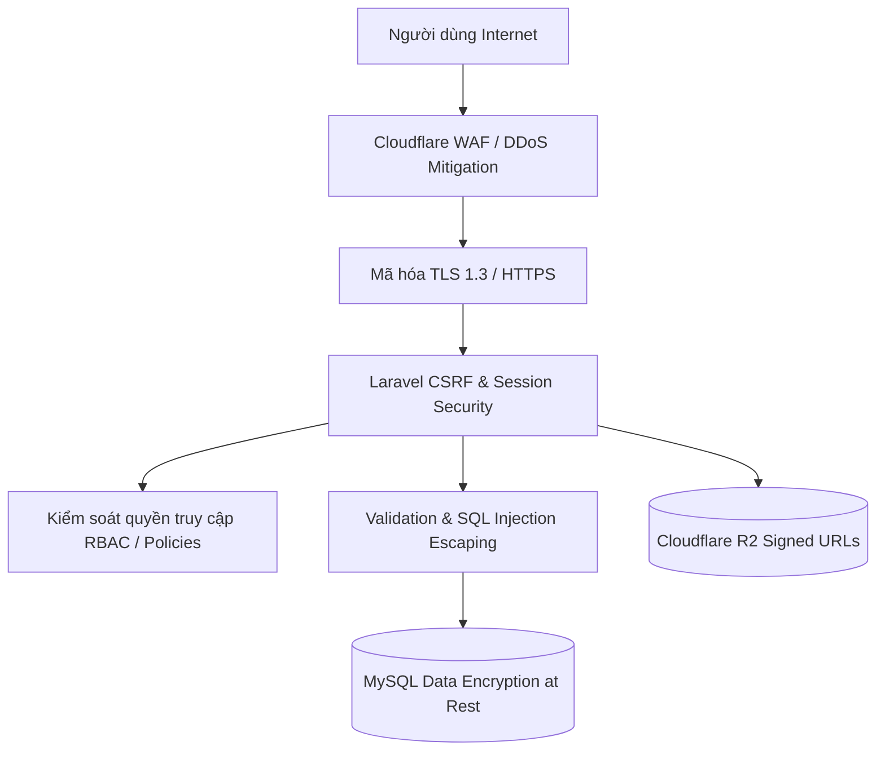

# CHÍNH SÁCH BẢO MẬT & KIỂM SOÁT TUÂN THỦ (SECURITY & COMPLIANCE SPECIFICATION)

```text
Document ID:     TP-SEC-001
Classification:  Internal / Security Standards
Version:         2.0.0
Author:          Chief Information Security Officer (CISO) & SecOps Team
Status:          Mandatory Policy
Date:            2026-10-14
```

---

## 1. NGUYÊN TẮC BẢO MẬT ĐA TẦNG (DEFENSE-IN-DEPTH)

Hệ thống TaskPilot được thiết kế với cơ chế phòng vệ theo chiều sâu (**Defense-in-Depth**), áp dụng kiểm soát an ninh tại mọi tầng:



---

## 2. MA TRẬN PHÂN QUYỀN TRUY CẬP (ROLE-BASED ACCESS CONTROL - RBAC)

Hệ thống phân định rõ hai tầng quyền hạn: **Quyền hạn Toàn cục (Global System Roles)** và **Quyền hạn theo Dự án (Project-level Permissions)**.

### 2.1. Ma trận Quyền hạn Dự án (Project Permission Matrix)

| Quyền hạn (Permission) | Mã quyền | Project Owner | Project Manager | Team Member | Viewer / Guest |
| :--- | :--- | :---: | :---: | :---: | :---: |
| **Quản trị toàn bộ dự án** | `manage_project` | ✅ | ✅ | ❌ | ❌ |
| **Mời & Phân quyền thành viên** | `manage_members` | ✅ | ✅ | ❌ | ❌ |
| **Tạo mới công việc (Task)** | `create_task` | ✅ | ✅ | ✅ | ❌ |
| **Chỉnh sửa & Kéo thả trạng thái** | `edit_task` | ✅ | ✅ | ✅ *(Task gán cho mình)* | ❌ |
| **Xóa công việc** | `delete_task` | ✅ | ✅ | ❌ | ❌ |
| **Ghi nhận Worklog cá nhân** | `log_work` | ✅ | ✅ | ✅ | ❌ |
| **Xem bảng Kanban & Timeline** | `view_project` | ✅ | ✅ | ✅ | ✅ |
| **Xem tài liệu nhạy cảm** | `view_confidential` | ✅ | ❌ | ❌ | ❌ |

---

## 3. PHÒNG CHỐNG CÁC LỖ HỔNG THEO TIÊU CHUẨN OWASP TOP 10

1. **Chống SQL Injection**:
   * Tuyệt đối không nối chuỗi thô vào câu lệnh query.
   * Tất cả các câu truy vấn `LIKE` tìm kiếm (như trong `QuickSearchController`) bắt buộc phải lọc ký tự đại diện bằng `addcslashes($term, '%_')` và sử dụng PDO Prepared Statements.
2. **Chống Cross-Site Scripting (XSS)**:
   * Tất cả dữ liệu hiển thị trên giao diện Blade bắt buộc dùng cú pháp escaping `{{ $data }}`. Cấm tuyệt đối `{!! $data !!}` đối với nội dung do người dùng nhập từ bên ngoài.
   * Trình duyệt được áp dụng chính sách Content Security Policy (CSP) chặt chẽ.
3. **Chống Cross-Site Request Forgery (CSRF)**:
   * Mọi HTTP request làm thay đổi dữ liệu (`POST`, `PUT`, `DELETE`) đều được xác thực qua token `csrf_token()`.
4. **Chống lỗi kiểm soát truy cập đối tượng trực tiếp (IDOR - Insecure Direct Object References)**:
   * Mọi API thao tác trên Task hoặc Project đều kiểm tra quyền sở hữu qua Policy:
     ```php
     $this->authorize('update', $task);
     ```

---

## 4. AN TOÀN LƯU TRỮ VÀ TỆP TIN ĐÍNH KÈM (SECURE CLOUD STORAGE)

* Tệp tin tài liệu và bản ghi cuộc họp lưu trữ trên **Cloudflare R2** không được mở quyền đọc công khai (Public Read).
* Khi người dùng cần tải hoặc xem tệp tin, máy chủ backend sinh một đường dẫn tạm có chữ ký bảo mật (**Pre-signed S3 URL**) với thời gian hết hạn tối đa **15 phút**. Sau thời gian này, link tự động vô hiệu hóa.

---

## 5. NHẬT KÝ KIỂM TOÁN VÀ PHẢN ỨNG SỰ CỐ (AUDIT TRAIL & INCIDENT RESPONSE)

* **Audit Logging**: Các hành động nhạy cảm (Đổi mật khẩu, Phân quyền Admin, Xóa dự án, Xuất dữ liệu nhân sự) được ghi nhận vào bảng `audit_logs` gồm: `user_id`, `action`, `ip_address`, `user_agent`, `payload_before`, `payload_after`, `timestamp`.
* **Kế hoạch ứng phó sự cố**: Khi phát hiện rò rỉ hoặc tấn công bất thường:
  1. Khóa phiên đăng nhập của tài khoản khả nghi.
  2. Kích hoạt chế độ bảo trì (Maintenance Mode) nếu cần thiết qua `php artisan down`.
  3. Thu hồi toàn bộ Access Keys và đổi secret credentials trên Cloudflare R2 / Database.
  4. Phục hồi dữ liệu từ bản sao lưu gần nhất và vá lỗ hổng trong vòng 2 giờ.

---

*Chính sách an toàn thông tin áp dụng bắt buộc cho toàn bộ hệ thống TaskPilot.*
